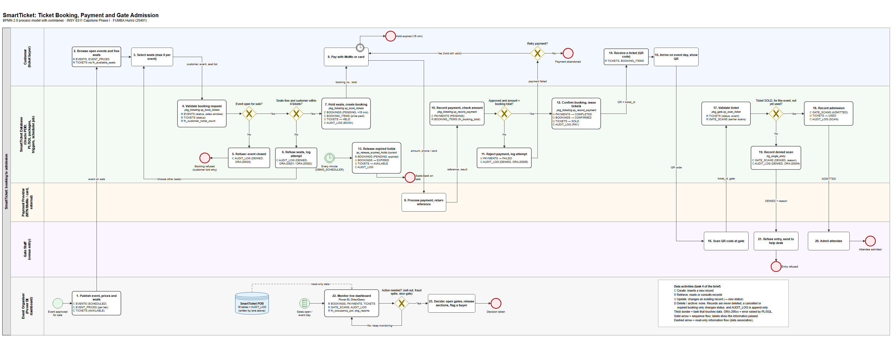
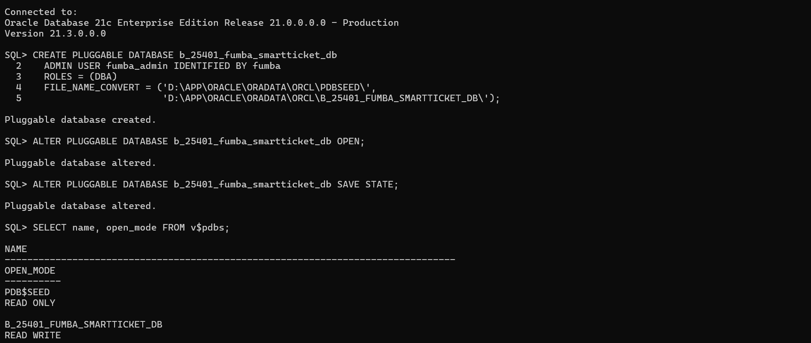
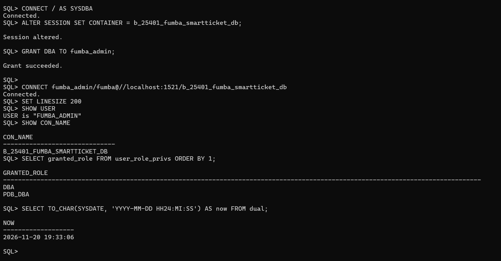
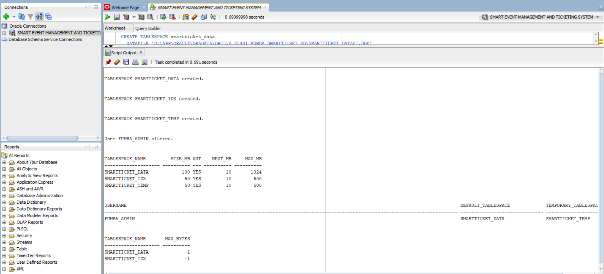
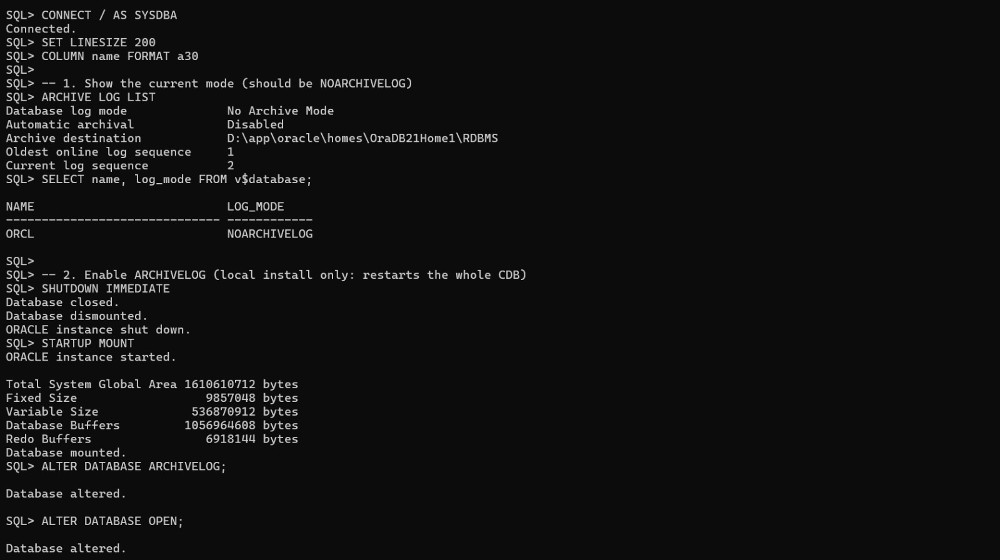
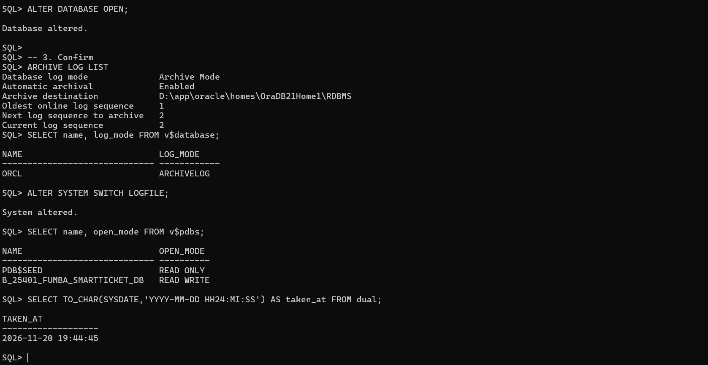
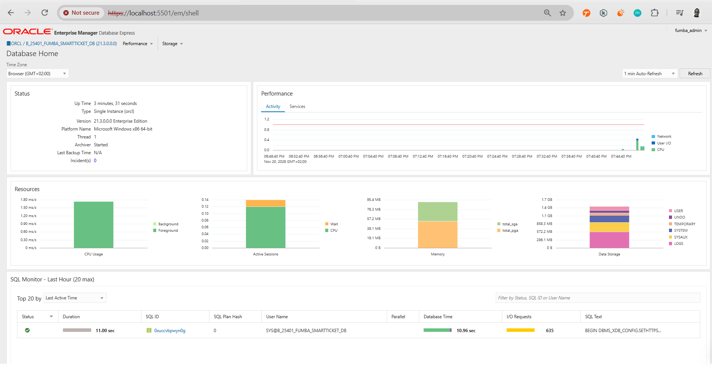
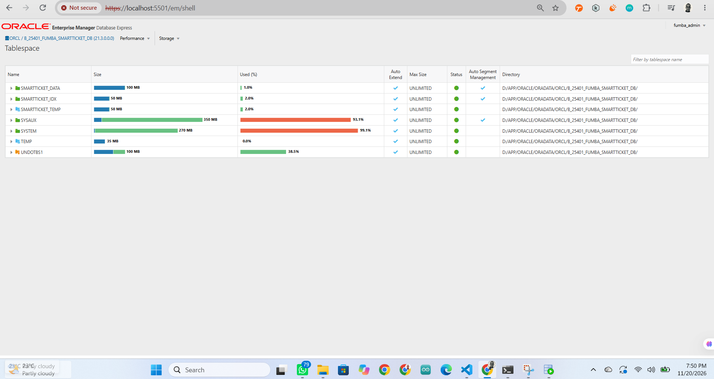

# SmartTicket — Smart Event Ticketing System

**Oracle PL/SQL Capstone Project · INSY 8311 Database Development with PL/SQL**

| | |
|---|---|
| **Student** | FUMBA Huriro |
| **Student ID** | 25401 |
| **Institution** | Adventist University of Central Africa (AUCA), Faculty of IT |
| **Instructor** | Eric Maniraguha |
| **Academic year** | 2026–2027, Semester I |
| **Repository** | https://github.com/fumbaking/fumba_25401_smartTicket |
| **Current phase** | Phases I–III done; next: Phase IV (tables and data loading) |

## Deliverables by phase

Files stay in the folders that each phase's instructions require. This index groups them by phase.

| Phase | Focus | Status |
|---|---|---|
| 0 | Research, data source, proposal | ✅ Done |
| I | Business process modelling (BPMN/UML swimlane) | ✅ Done |
| II | Data sourcing, normalisation, logical design | ✅ Done |
| III | Pluggable database (PDB) creation | ✅ Done |
| IV | Tables and data loading | ⏳ Not started |
| V | PL/SQL development | ⏳ Not started |
| VI | Advanced programming and auditing | ⏳ Not started |
| VII | Documentation, innovation, final presentation | ⏳ Not started |

### Phase 0: Research, Data Source and Project Proposal

| File | What it is |
|---|---|
| [README.md](README.md) | Project overview: problem, objectives, data source, innovation, planned tables and PL/SQL, references |
| [docs/research/research_log.md](docs/research/research_log.md) | Research log with 8 sources (APA, type, link, key finding, gap) |
| [docs/proposal/FUMBA_25401_SmartTicket_Proposal.pdf](docs/proposal/FUMBA_25401_SmartTicket_Proposal.pdf) · [.docx](docs/proposal/FUMBA_25401_SmartTicket_Proposal.docx) | 2-page proposal |
| [docs/presentation/FUMBA_25401_SmartTicket_Phase0.pptx](docs/presentation/FUMBA_25401_SmartTicket_Phase0.pptx) · [.pdf](docs/presentation/FUMBA_25401_SmartTicket_Phase0.pdf) | 12-slide presentation |

### Phase I – Business Process Modeling

**Selected process: ticket booking, payment and gate admission.** It starts when the organiser publishes an event and its seats, and ends when a ticket holder is admitted or refused at the gate. The database checks the event is open, the seats are free and the buyer stays within 6 tickets, then holds the seats for 15 minutes. It confirms the sale only when the payment matches the booking total, and admits each ticket once. Unpaid holds are released by a scheduler job. Every refused attempt is logged, and the organiser follows sales and fraud attempts on the Power BI dashboard.

| | |
|---|---|
| **Modelling tool** | diagrams.net (draw.io) |
| **Notation** | BPMN 2.0, one pool with 5 swimlanes: Customer, SmartTicket Database, Payment Provider, Gate Staff, Event Organiser |
| **Published diagram** | [Open the published diagram in diagrams.net](https://viewer.diagrams.net/?tags=%7B%7D&lightbox=1&highlight=0000ff&edit=_blank&layers=1&nav=1&title=SmartTicket_business_process.drawio#R7V1bU%2BO6sv41roIHKEnO9THXGWoDwyLMOmueUoqtJFo4lrescNm%2F%2FpQk27FjhRhwEjNjeADfZXer1f31zbIHq5c59YiFwJKFwrKHFkI4CC5dihccr8JLnwgLIQsBvCB%2BdMJkhbl4oM6jPAaCJQ4JtBBYEJ9wLBiXF9gjyx5Ed7EQoK6%2BNJSXCnXpxSxY%2BfrePl4RfbzP2CP1FxYCgsmHuisahpT5yS1XL984DpY3zCWehYD7oq%2BDLQD0vdxXvacb71jw%2BOFws2NC%2Fxc9EcanralLwsyJgjFP0CC702G%2BTxyR2Yc5Z8%2FZ0%2BbMyz41wIvoiWCzY%2BJgj%2BRO%2Bz%2FqiqXea9sgdfp3QhfL%2BNHJkRWOz452hEvssufULvXlOGMi%2FoYD4nkpqujrxjuOJiPjCQe8fYGgQrKUvOgJe%2BvoBS3U8oRl92dyhOI1eu%2FWf9dyWP0588VFqKjSQyB42RyxUGsh%2F6a5zu5ZCCQcmDDNwELgDr%2Bu5DgRwL5rIfANC8nevQ0n6WFYaDyLb50MjW%2FvCQPs7x0vRKbx9u9ubi0E0CWQH48zh4ShpFbEuc9ULOWdn%2BnKwz6Rh6wBsvptC4Gr28kvC4GODeW8GuAgFMyXb3En55o8IX32%2BOdNX36P72tOuZw1Z6jZAPA89ab6NeJXQ5k3QoK8yP1LsfIsewgtu489uvAte%2BiRuTzyRLigDvZ60e4VdV15cf95SQWZBNiRd3rmOEhuLy8hLzv5B6bnM2ErIvirhcBLho2jidzQW8%2BpSYFi1l%2BmJkSzFU3GaCIukvtuWNVC44hbzZwbMOblGDfHeLM3hFTmy8bEzX5dZ0k99xq%2FsrUceSiw8xhv9TmRPHUXfyq4tesGy08E5P0Yp%2F9jvsBetCMUmItIrNnZMybyEdFpkm%2BjsyCS29TzBsxjXI3YHgH5ewgytkFBOkIYi%2BTPUFJ%2B9qmzDgVbEZ4j6SA50LKQ%2FYItu38mYnEyW78Sfl6AmHvpABHYMUtyZJDb0bNgnixje9wZj%2BXdo0GMdx0XnD2S1JGO%2BilK0Jj%2Fd9LUzhLVQFPYNtAUlUZSd%2Fbm%2FERgiAWeKSm5Ie0Pjh2l5NwN%2B2oKJ4furi00nvx1rb6D84gXUhAPUicIThcLwvVeEDpL4q49yTjgXzarGJM0xv1x4w0mSY4fl0kS4u9lE7tZFpsE%2BDXHJxvN4I6zJ%2Bpmp%2F%2FNg1ytb9iNFOnyYQg4mLtZbiAvgnAfexUj%2FHjcHYM3CJ8cPy7hm62ihIeNsgi%2FUOreFuUjHXAi8HyepvkT8dfyAPEFf60YTfvj5psSPzl%2BXJq2QWGZD8qiKeOLHElHT3oq%2F%2BAL7NMwO5fv2LMS0f2r1F4Xh8sZw9ytGKHb8vcNQifHj0voLjjq4h6%2BSWUcBJw9EVcZ1pKyIY4tzDQZlziQ%2F65eFhIjuJQAwyVRt8go4AHhdEUEkd%2BReB4NQnK32dVna%2BFRnwwSQ19SGoeB3pjTF%2BIWIL28yMMz4vWx87jgbO27Me18plgteo62AXxXLjZ2P3xdzZgcqEZTPIOK3hk3R10TQ6BRe2ijlMF2LZ9%2Fx0IqpHViD2dMCLYyWHSCBfFwY%2FChU9gKSM%2FRndwFmygrR9p57moZNIISjDoB38IitFEML6VasJ55NJRWuWYapfIFnDrKOtdwQkiwCN%2FCEFz6ZAQMpJV9ERnWvciwzoAIEvSw%2ByvMF9S%2FUATp2WqXZJKL%2BKP04CVq5sGG%2BOnyjgqkiplic6IN%2B%2B2xOnPHtcmrDN56PwuN9UOS3XglmcefhfLP6O%2FR7cNEghCTwffR8Of1aHi%2BG16pxnCnd%2FdXg5EadKDWDUGVAVjZUT9cDf4z0l%2B593fv6rrXvx6l4R7FgzvQHiWJpATTSA93IoHV2SHTUnIzJ3D0j1EhHSvlJC0Q08CSQ3wta3dCS2GAHYmx2MONxRKLJnjZKlU2IZSVTbGoSskm2DYIp04ZwgntF05ICqe%2BhJilssoC4sciaiOX5pyQLy6exs1xr1Ng5tyXIJ6kZM%2FO%2FQ9N9mMMeTPZnyiWlPan%2BAlTD888Mt2mdz3zMzM%2FDQAWnv6tbrHp30YlTH97%2F%2FS35fSfEE%2Fqn8kMB2cr%2FGIh0JKvrRYtJRDOzYz2O3BCyVRv2M2sQmoQ%2Bk2DtdMqQ%2Bg39lO9Ian%2BN%2Faoq8GLjdOBk%2F%2BuSSje58iie71Y3cumyY0VPC6mGhqn%2FuIyDKZyINGetOSh9UqzQxEOBRbrGEDGnjImnqnvsufzL7HsRC9Q5cHO%2FWTSR6w5ddjaF%2FXKuEtGaj%2FKTunYAlsqMSy2JnY7n5eOC7gTB4p03xQGZI%2BLwUASF37Gr2g3EsSXbDVbh3uRoMXzw6u6P3lxvHVIn0gRNOiyaWSJ4cgM7Q1bI7AfQdqF82g4Z5uPEvQng%2FPIRa5ExunYjeyymnffx%2BZVxnlfhi7V3L%2BqNuWqek%2Fm65BoX36E9ADHY6HEF2tgZ4eI7f0cXj1Mr398kyvCcHR7NRpq39h71wQpaufUVx9734A%2FMd73bv%2B4710gAIBdAykfnfvtTlalNsXuGHXqMiwpMuVqWrs5IdBPac7RGdtMe7YxGYCQkXsIPC9NHsGv6mEgfsa5IAhfUR8Lgkw8N%2BqPRiYu7bfhAA5K8i9AWOq60%2BpkFRbUQEdzMCzyGN4kstIjWE5jdCkmk9F%2F1I%2Fs99iYqnWZaukyEIDTKTOt%2FcpMK6XMJMCQtDI9JqUdFoKsAlHrNH%2B8TgOTkKZ4D6q1nI9KhW7zhFqOaO8XC20pFr5rLSYlFBxOtpDEGj%2BssGzq%2F%2Fjxn6vbbwqAuxvdDq9uv2k6WqgPmzKRgPpV9lFH459ePYxutGtdBlKo%2BUbdDw58gJpSldg%2F8J%2BlAJ%2FWCFmdltWVE%2B776HpY4a%2BdWcnkp6%2Fl%2B4e1PrjlD2w0imGfEJYh4Dv7BXznUuc5bbKIorBlBYvqqOXaC1jICwjhdnyrwQ3YOpAbcCamgprSU34f3GEmj16pYW7AB%2FXOu1llN3OVTXzUyKpyTUNQoilNAZQBV5GXgHIDXBVpbslhcJZa7ms8yoRHeVuYAde02pXHuA0xJKJmpwzKogwIHIAX7a0AWXg8%2FEp096853UudNxNlsQZxLs1AwapizX2NrxJOfKnm1etPlIK0m%2BINmF167Pbxlh4RP%2FvNoGigASaHSY0iS3NnSZxHOYjVlp%2F9qLYkV2ObJiOrrckd9sFd79dNHI8SWZNVjufIGY9zfxrBFlPBhErAq82bj5k3TbgV2tHJi52uKdq5UYKnJB%2Fu2Nuk9mgvSSxRgDqeSbZXqVi1k6RaTpJ283ROElgktQfqVexfHT%2BbWcV%2BA0fJUTCx1PKRBsXGvavr0ZeBxVIOnsQP0qwXkg9P%2FJzL3eQI6R4ocH6RD6G%2Bj8YXz%2FB6pfjsSgEPYeh22tn1IjZnjrBekCmeYd%2BNK%2FUYa0NEZ8TATA22VCH4pxhndbtonyZyuBzjAnl8UCXyDZg%2Fp3yVVm3likTDUNWiyHtGa4v6C6lEgx83d9ejh49qRUcZesq1nB367fjq%2FqbSQzc7Zyc%2Fvo5z9q73q9Y5P6xzdpsn9M2G03%2FZzJSbooa4ov5aEENs8bB%2FM5nG1RDuz3%2FvsiU7nHtHKlpSclAxhPbpoooFLJAbDG0NbnhEFwbdeA2XzHOPpUUovUENIfZqTqPHgzNnzUPGz%2BtM0fdHekXf8vzrqRKjf%2B6u7r%2BgIpFUU%2Fka2kStRXxMrKNtsQ6OqUaQWFi6O9NGZlg5V5n%2F25U6%2B8qBH51ylYvGVpyhfcyQD1igBAVsRP5%2FIpFMBMhFUiP57K97JQRdcl5XG9q%2FyMjVfMunXcvuz5TsSQrGxlBfq1jsTLNTxtwpkGgOVaZ5j3M9dZifyjV3ZWSQqgayZM8WAn%2Fd1%2FFSRQlvo9PF6wpYICkPqqy8iaP6RiRSUnmZZZcRLOrguFSZ5t2EboJTRscVSLOC7a0KTfHieDTgXn5EidmHDvanuafXZvaegkaRkZ0pm1bBWLhvvYfRdDLo3aqhE8w9qlLIJdXDGkr%2BqPqNGt39cXDtQ8XB5TWIpIGFdmYMkjJHYknDbElin8nzXtXZqp5FHelQrZg41D5hFSRYIIMMdjKR3bhIc6w%2FPII6K4Z7w5urh4cP17Y%2BIcT5c%2FJ1Ivbk565XuA9LoU4L7UtvO1xda1ggqQh2M2LIJT5VvqtQWU9H0aMFX0xD6i88MlVdYOockoISMB1NywkOWaWrEewNBG7UcubDcqbV3m74ZVClO%2BAwqrRABTLZkMpkkz1ARRTv77ukBmIKATGddnMvEHOoQtlkKlVTIQyusl5CRJA9p%2FaSVSFidy9f2aCzt%2BvGwbxfqEDeEIKZ8mqRdqBge6IS1VTz1yXxAqW6hI%2B1OCkiTlqd0%2BG6ZBqrmNsxfJq4IFNCtBYkp3W3d0uWOKjd2Cqx0DhegoAMhtsncbKNbGWv2vJ7le8wg6CqQypbyoS6xJhUl7YDjVIxrc9crrjycTP5hVXzRJk7w55I4b7j8aRyscChYJzsF4F70cSRPUbjoYmJI6y%2BzL5Rna0CDnFhwLQoQya1t5R%2BiStDGtMkai8R1clXNR%2B3aZfxQv%2FOocgO810lek7YRfG9atPeNoqgcbo%2BiqhIrzKV43TDfCqU98LT8Q9J89UjwTrpDrBSZRtSThzx15p8WYTnuJHI8pttMpzkVoImfwlH6eDt9atKjWuY46wD7Duv08CJe44%2BLqacBIzXvd0%2BISq3kzcarWLp6aX0sMlHCvUctX4g4BPiRk5bcBYSz7tg64jwc47XCgAP6COJjE1PxYhJ7fa89vIe1cu7l8PsTmNf58CDuXlRgewgpLKDhsShbtTuJlIMJYuEMXYf5w6FRHFotH%2FuYVUbRar461fVX%2F2PRzf2N7kGWay0Zeoke0BwQxI6j25IBtDefSDwI%2FFreKM6OOlelmrbJ1P4PbJQSOcOMfNxZVnp7HnduNEsoG0NsZAyCTuCPlFBlbl7JrCEX2UWD2BzFTOlCt1zSubn77M4Tu6pHOgy%2FUpaUz8kXDd5VnrDs5LX2lteWZVWluGh5Cl6BU6wygPVpamZH6499UL6NcIKh8%2F8DNyEEM4S%2Bwuiu22rxEwairilVBS8cJYOstGk%2BlTfzHYPjuG4yIT4xDsOiUdU7LLuDoK5s6Qx5aSw3YRnqHfnRL3bkzKtXXWtq%2B6q%2BNPBvkM8T0VwMG586091M9nkNm9qAjLfe83QJx3aq%2BsJpl3%2FKpISBwHx3Qt56WV%2BlA9LqnLvZoy76j11GcJIwoilCuMXbO0s1fMkeHm5iSN4eUmuIJwrpueYhnrUcqR31xYaT%2F66Njx5wjyqovE4Vyq%2Fvk0ou%2F2qkrpgLk0B9bnVkhNuMki0vKP%2BnPEVjsyMAIchcQ3PGeJwSfIPkjP1Ivqe2TvNtQly5kaiNwyZQ9XB88t326egAMpbtDB4V%2F1kFLpyEV5kb3WJjhHf1OrbMCl0iZb3mfV3DvdXhifugkyizUg9Sn3J7GcvqGWlPznx3Z7iEns485jzqHeNqbdfbScvVPwTnSX%2F%2FyVHoWxDuTV8iQalNl7jDemH%2Bye9kbpKbm4uU1vxdfqzyG%2Bxk97RrpCtuROrvTH95fTmCyLi0LU3eSKL%2BUdbnHhYKNGZepaJ9hvCJ3cuxgt57DUG8ndnCVefOTYM8SvND3uYY8MPv2IGK505BDRwBqoiZ9i1lDiklBDIwAh2FRkhn9K9yakcZFNIZF8w5Z0JxR%2FDLFmpAQ7DLLaBWRqHZpYe56obUHxCwKgvwtRT7%2BSOVKPerYfCKMRvo5foO36YE5u1SDqoSGrkuWxRSa0l7wa5ZV9eTYEVEjgLk5rSrCIrtH8HmQA%2BIhPgUWRCM88ImZ7oVeOHfJriLxLWy8SBZcOikiZMt14mDrxMmIyYVhVZwdCYylkypjzUTCx16QNdJu1P4Q%2F7CGhH6xRG7nvtFgha2ae2ooo84x0XNOGb53%2Fe0DE0oKlXsSOIrnYlRVceo914qnx2qaEX3caqhmpLFF5tA4d0KskhvwVW%2BzFOOIasyHZUzppCqX67lVrTUHcLjIsKn5W3RuVx4bjHngo2XjJ%2FEwKgu4d%2F8eWr1U3%2FtquED3cMoqr7Nk9eNpsnYMvmNkbc6ZTMlnmQONU%2FWIemymihP9Q%2FcaClsmvyd4PKCcXWdn3X0oViq3ZRHBSOjC2vDPhUSbepodhnjT6Va8KZvKKwkg4rQ%2FW8pBcamGPqEbdekEqVEyaQeo%2FH%2FLJ1giWpa29lezfKXpK6ZiwJnMlmOorlqLriSdYcPv9DvWc2yP42DiOxGl8FUjCUv%2FqSq1eFAciGCU5IdZKtHEvUoPTBecKo0VTSt2qs2lCzQolR5ElXyCw3VNLYQb8hAg0rZffa5jicTcevSgEtdnPbQ1qyVovy6LPqihKlValqV1NaG1XlMqHJZworF4csu7xkiwF2yua%2BOhL5wOLOZCjBSgagopZZEun%2BTPUaWCJTNE1M0aqc%2BGlsQTqdsiEdlIeWUyveIGkIVgeDlMh8plA2WMmAIdSpV6fDCiJDZNCimotTt8ZsDo3ZGFelSoK6Nqhdkgd2SRqZoVtJZsjDuXH7qZolSl0tTMFZCFSSJ2pQ98BJ%2F8Do9El1GqkcS%2BSR3bjRUVTQXbdpqmVGqTLDFFCHKhnaYjf%2BXOj%2FKLyAoElmbFqOVI4hanD0wJ7BpEdDVjxUs4xQyxCPvSkJp4u%2FnYw7VOHiNHPIW7i6kp1%2Bmty4k63duCzN2lLlQA3801Q%2FJUNZhxEocc%2BYdzHPpX2CbIEuyDJtt9t8My8TotabF3weebXbtWw7rIJscDEuKplRbteVJg4OrZkwd1TJABi7WwuGwwoG26wFJ7XpK1c2zwi2qhrIj4TI7o4r3c5IJXL%2FkQYTPKLUQJWLkWpsJaNB2HinerN9xXv1GwuNOZNlwDeny0YNN8wlmzNcihccr1Inzanky9H%2FAw%3D%3D) |
| **Explanation document** | [docs/business_process/business_process_explanation.pdf](docs/business_process/business_process_explanation.pdf) |

| File | What it is |
|---|---|
| [docs/business_process/business_process_diagram.pdf](docs/business_process/business_process_diagram.pdf) · [.png](docs/business_process/business_process_diagram.png) | Exported diagram: 23 numbered tasks, 6 decisions, CRUD marks on every data activity |
| [docs/business_process/business_process_explanation.pdf](docs/business_process/business_process_explanation.pdf) | Process definition, actors and responsibilities, data-generating activities (C/R/U per task), one-page process explanation |
| [docs/business_process/business_process_model.drawio](docs/business_process/business_process_model.drawio) | Editable diagram (open in https://app.diagrams.net) |



### Phase II: Data Sourcing, Normalisation and Logical Design

| File | What it is |
|---|---|
| [data/raw/](data/raw/) | SeatGeek dataset exactly as downloaded: `venues.csv`, `performers.csv`, `events/` (30 daily files), `event-listings/` (30 daily files), publisher schema and dataset card. Found in Phase 0; stored unchanged. |
| [data/events_all.csv](data/events_all.csv) · [data/event_listings_all.csv](data/event_listings_all.csv) | The daily files joined into one file each, with no values changed |
| [data/dataset_card.md](data/dataset_card.md) | Source, licence, format, size, date collected, what one record represents, and the data-quality counts |
| [data/README.md](data/README.md) | Short guide to the `data/` folder |
| [docs/design/normalization.md](docs/design/normalization.md) | UNF → 1NF → 2NF → 3NF with real rows, mapping of every raw field, class-demo trace |
| [docs/design/erd.png](docs/design/erd.png) · [erd.svg](docs/design/erd.svg) | Logical ERD, 16 tables, crow's-foot notation |
| [docs/design/data_dictionary.md](docs/design/data_dictionary.md) | Every column: meaning, key, required, unique; relationships with cardinality and optionality |

### Phase III: Database (PDB) Creation

Oracle Database 21c Enterprise Edition 21.3 (local install, CDB `orcl`).

| Item | Value |
|---|---|
| PDB | `b_25401_fumba_smartticket_db` (open, state saved) |
| Admin user | `fumba_admin`, DBA role, default tablespace `smartticket_data`, temporary `smartticket_temp` |
| Tablespaces | `smartticket_data` 100M → 1G · `smartticket_idx` 50M → 500M · `smartticket_temp` 50M → 500M (all AUTOEXTEND ON NEXT 10M) |
| Archive logging | ARCHIVELOG enabled on the CDB (local install only) |
| EM Express | https://localhost:5501/em |

| File | What it is |
|---|---|
| [database/setup/01_create_pdb.sql](database/setup/01_create_pdb.sql) | Create, open and save the state of the PDB |
| [database/setup/02_create_user.sql](database/setup/02_create_user.sql) | Grant DBA to `fumba_admin`, set the EM Express port, test the connection |
| [database/setup/03_tablespaces.sql](database/setup/03_tablespaces.sql) | Data, index and temporary tablespaces; user defaults and quotas |
| [database/setup/04_archive_log.sql](database/setup/04_archive_log.sql) | Archive log check, why it is a CDB setting, steps to enable it |
| [database/setup/05_verify.sql](database/setup/05_verify.sql) | Verification queries; output in [screenshots/05_verify_output.txt](screenshots/05_verify_output.txt) |
| [screenshots/](screenshots/) | SQL\*Plus, SQL Developer and EM Express screenshots for Tasks 1–5 |

#### Evidence

**Task 1: PDB created, opened and state saved**



**Task 2: connected as fumba_admin to the PDB, with the DBA role**



**Task 3: tablespaces, user defaults and quotas (SQL Developer)**



**Task 4: archive log mode before (NOARCHIVELOG) and after (ARCHIVELOG)**





**Task 5: EM Express on https://localhost:5501/em as fumba_admin**





**Task 6: verification output** ([screenshots/05_verify_output.txt](screenshots/05_verify_output.txt))

```text
PDB_NAME                       USERNAME       RUN_AT
------------------------------ -------------- -------------------
B_25401_FUMBA_SMARTTICKET_DB   FUMBA_ADMIN    2026-11-20 19:51:50

NAME                           OPEN_MODE    CREATED
------------------------------ ------------ ----------------
B_25401_FUMBA_SMARTTICKET_DB   READ WRITE   2026-11-20 19:29

USERNAME       DEFAULT_TABLESPACE TEMPORARY_TABLESPACE ACCOUNT_STATUS
-------------- ------------------ -------------------- --------------
FUMBA_ADMIN    SMARTTICKET_DATA   SMARTTICKET_TEMP     OPEN

GRANTED_ROLE
------------
DBA
PDB_DBA

TABLESPACE_NAME    MAX_QUOTA
------------------ ----------
SMARTTICKET_DATA   UNLIMITED
SMARTTICKET_IDX    UNLIMITED

TABLESPACE_NAME    CONTENTS      SIZE_MB AUTO    NEXT_MB     MAX_MB
------------------ ---------- ---------- ---- ---------- ----------
SMARTTICKET_DATA   PERMANENT         100 YES          10       1024
SMARTTICKET_IDX    PERMANENT          50 YES          10        500
SMARTTICKET_TEMP   TEMPORARY          50 YES          10        500

NAME                           LOG_MODE
------------------------------ ------------
ORCL                           ARCHIVELOG

EM_HTTPS_PORT
-------------
         5501
```

### Phases IV–VII

*Not started yet.* New files will be listed under their phase here.

---

## 1. Problem statement

Rwanda's events sector is growing fast. MICE revenue reached **US$95 million in 2023, 48% more than in 2022** (Kagina, 2024), and venues such as BK Arena, Amahoro Stadium and the Kigali Convention Centre now host concerts, matches and conferences every month. Ticketing has not kept up:

- **Scalping and bulk buying.** Brokers buy many cheap seats early and resell them at higher prices (Courty, 2003). This rent-seeking wastes about a third of the efficiency gain that resale can create (Leslie & Sorensen, 2014).
- **Fake and duplicate tickets.** The same seat can be sold twice, or a screenshot of one QR code can be used by several people at the gate (Rafati Niya et al., 2022).
- **No transparency.** Local platforms are closed products. Organisers see only total sales, not live occupancy, denied fraud attempts or an audit trail of who changed what.

There is no open, rule-enforcing database that guarantees **one seat → one sale → one entry** and reports it live.

## 2. Objectives

**Main objective:** design and implement an Oracle database with PL/SQL that sells, validates and reports event tickets in real time, and that prevents double sales, scalping and fraudulent entry.

**Specific objectives**
1. Normalise the real SeatGeek events dataset into 3NF tables and load **1,364 events, 194 venues and the real seat positions from 30,000 listings** (see the [dataset card](data/dataset_card.md) for exact counts).
2. Build a PL/SQL package that **books, pays for and cancels** tickets, with full exception handling.
3. Enforce anti-fraud business rules with **triggers**: no double sale, a maximum of 6 tickets per customer per event, single-use gate entry, and no booking after the event has started.
4. **Audit** every data change and every denied attempt, and apply the Phase VI weekday/holiday restriction rule.
5. Deliver a **live Power BI dashboard** connected to the Oracle PDB for organisers.

## 3. Data source

**SeatGeek Events & Ticket Listings Dataset** by Rebrowser (2026), **CC BY-NC 4.0** (educational use allowed), with no personal data.
Links: [Hugging Face](https://huggingface.co/datasets/rebrowser/seatgeek-dataset) · [Kaggle](https://www.kaggle.com/datasets/rebrowser/seatgeek-dataset)

| Entity | Records |
|---|---|
| Events | 1,364 unique (1,397 snapshot rows) |
| Seat listings | 30,000 |
| Venues (with capacity, coordinates) | 194 |
| Performers | 265 |

Details, sample records and known limitations are in [data/README.md](data/README.md).

## 4. Proposed solution

SmartTicket is an Oracle 19c+ pluggable database. **All business rules live in PL/SQL.** A sale succeeds only when the seat is free, the event is open, the buyer is under their limit and the payment matches. Each ticket can be scanned in only once. Every action, including refused ones, is written to an audit log, and Power BI reads the data live.

## 5. Planned tables (16, in 3NF)

The full design is in [docs/design/](docs/design/): see the [ERD](docs/design/erd.png) and the [data dictionary](docs/design/data_dictionary.md).

| # | Table | Purpose | Key relationships |
|---|---|---|---|
| 0 | `CATEGORIES` | Category hierarchy (sports → basketball → nba); added in Phase II | Self-referencing; 1 category → many events, performers |
| 1 | `VENUES` | Venue, city, country, capacity, latitude/longitude | 1 venue → many sections, events |
| 2 | `PRICE_TIERS` | VIP, Premium, Silver, Bronze | 1 tier → many sections |
| 3 | `SECTIONS` | Seating sections of a venue (e.g. "Section 211") | FK venue, FK tier |
| 4 | `PERFORMERS` | Teams and artists | M:N with events |
| 5 | `EVENTS` | Event name, category, start/end, status, sales window | FK venue |
| 6 | `EVENT_PERFORMERS` | Bridge table for the event ↔ performer M:N relationship | FK event, FK performer |
| 7 | `EVENT_PRICES` | Price in RWF per event and tier | FK event, FK tier |
| 8 | `TICKETS` | One row per seat per event: row, seat, status (AVAILABLE / HELD / SOLD / USED / CANCELLED) | FK event, FK section; UNIQUE (event, section, row, seat) |
| 9 | `CUSTOMERS` | Anonymous buyer code, region, registration date | 1 customer → many bookings |
| 10 | `BOOKINGS` | Booking header: customer, time, hold expiry, status (the total is computed by `fn_booking_total`) | FK customer |
| 11 | `BOOKING_ITEMS` | Tickets in a booking, with price paid | FK booking, FK ticket; a ticket is in at most one active booking (`trg_no_double_sale`) |
| 12 | `PAYMENTS` | MoMo / card / cash, amount, reference, status | FK booking |
| 13 | `GATE_SCANS` | Every scan at the gate: time, gate, result (ADMITTED / DENIED) | FK ticket |
| 14 | `PUBLIC_HOLIDAYS` | Dates used by the restriction rule | — |
| 15 | `AUDIT_LOG` | User, action, table, time, status (ALLOWED / DENIED), message | — |

## 6. Planned PL/SQL features (and where each is used)

**Procedures**
- `sp_book_tickets(p_customer, p_event, p_ticket_list)` puts the chosen seats on hold and creates a `PENDING` booking.
- `sp_record_payment(p_booking, p_method, p_amount)` confirms the booking only when the amount equals `fn_booking_total`, and marks the tickets `SOLD`.
- `sp_cancel_booking(p_booking)` releases seats back to `AVAILABLE` and marks the payment for refund.
- `sp_scan_ticket(p_ticket, p_gate)` admits a `SOLD` ticket once and sets it to `USED`.

**Functions**
- `fn_available_seats(p_event, p_tier)` returns the seats left, shown on the dashboard.
- `fn_booking_total(p_booking)` adds up the booking items' prices.
- `fn_occupancy_pct(p_event)` returns sold seats ÷ capacity.
- `fn_customer_ticket_count(p_customer, p_event)` is used by the anti-scalping trigger.

**Cursors**
- An explicit cursor in `sp_release_expired_holds` loops over `PENDING` bookings older than 15 minutes and cancels them, so unpaid holds do not block seats.
- `BULK COLLECT` with a parameterised cursor produces the per-event sales report.

**Packages**
- `pkg_ticketing`: booking, payment, cancellation and the custom exceptions
- `pkg_gate`: gate scanning and entry validation
- `pkg_reports`: analytics using window functions (`RANK` of events by revenue per venue, `LAG` for daily sales change, running totals)

**Triggers**
- `trg_no_double_sale` blocks adding a ticket to a booking unless the ticket is `AVAILABLE` or `HELD` by that booking.
- `trg_ticket_limit` (compound trigger) blocks a sale that would give one customer **more than 6 tickets for the same event**. This is the anti-scalping rule.
- `trg_event_open` blocks booking for an event that is `CANCELLED` or has already started.
- `trg_single_entry` blocks a second scan of a `USED` ticket and logs a `DENIED` attempt. This prevents shared or fake QR codes.
- `trg_restrict_dml` blocks INSERT/UPDATE/DELETE on weekdays and on dates in `PUBLIC_HOLIDAYS` (the Phase VI restriction rule).
- `trg_audit_*` (compound triggers) write every DML action to `AUDIT_LOG`. Denied actions are logged through an **autonomous transaction**, so the log entry survives the rollback.

**Exceptions** (user-defined, raised with `RAISE_APPLICATION_ERROR`)

| Code | Exception | Raised when |
|---|---|---|
| -20001 | `e_seat_unavailable` | The seat is already sold or held |
| -20002 | `e_limit_exceeded` | The customer would have more than 6 tickets for the event |
| -20003 | `e_event_closed` | The event is cancelled or has started |
| -20004 | `e_already_scanned` | The ticket has already been used at the gate |
| -20005 | `e_payment_mismatch` | The amount paid ≠ the booking total |
| -20010 | `e_restricted_day` | DML is attempted on a weekday or public holiday |

## 7. Innovation: live Power BI dashboard (Analytics dashboard option)

**Tool:** Power BI Desktop connected to the Oracle PDB in **DirectQuery** mode (built-in ODP.NET driver / Oracle Client for Microsoft Tools).

| Page | Shows |
|---|---|
| Sales overview | Revenue (RWF), tickets sold, sales by tier and category, daily trend |
| Event occupancy | Sold vs capacity per event, a venue map from latitude/longitude, events close to selling out |
| Gate & security | Admitted vs denied scans, denied scalping and double-sale attempts per day (from `AUDIT_LOG`) |

The dashboard only *reads* data. All rules are enforced by the PL/SQL procedures and triggers. It will be demonstrated live in Phase VII and documented in `innovation/`.

## 8. Repository structure

```
fumba_25401_smartTicket/
├── README.md
├── README.md             # [Phase 0] project overview, updated every phase
├── data/
│   ├── raw/              # [Phase 0 / II] dataset exactly as downloaded (never edited)
│   ├── *_all.csv         # [Phase II] daily files joined, values unchanged
│   └── dataset_card.md   # [Phase II] source, licence, size, data-quality counts
├── docs/
│   ├── research/         # [Phase 0] research_log.md
│   ├── proposal/         # [Phase 0] proposal (.docx and .pdf)
│   ├── presentation/     # [Phase 0] slides (.pptx and .pdf)
│   ├── business_process/ # [Phase I] BPMN diagram (.drawio, .pdf, .png), explanation .pdf
│   └── design/           # [Phase II] normalization.md, erd.png, data_dictionary.md
├── database/setup/       # [Phase III] 01–05 SQL scripts: PDB, user, tablespaces, archive log, verify
├── screenshots/          # [Phase III] evidence screenshots and verify output
└── (later phases add: more of database/ [IV–VI], innovation/ [VII])
```

## 9. References

- Courty, P. (2003). Some economics of ticket resale. *Journal of Economic Perspectives, 17*(2), 85–97. https://doi.org/10.1257/089533003765888449
- Iyamuremye, J. (2025, November 14). The wait is over! Tickets for Davido's Kigali concert, sponsored by Skol Malt, are now on sale. *InyaRwanda*. https://inyarwanda.com/en/news/the-wait-is-over-tickets-for-davidos-kigali-concert-sponsored-by-skol-malt-are-now-on-sale-1763145382294
- Kagina, A. (2024, April 18). Rwanda's events industry rakes in $95m in 2023. *The New Times*. https://www.newtimes.co.rw/article/16078/news/economy/rwandas-events-industry-rakes-in-95m-in-2023
- Leslie, P., & Sorensen, A. (2014). Resale and rent-seeking: An application to ticket markets. *The Review of Economic Studies, 81*(1), 266–300.
- Microsoft. (2026). *Power Query Oracle database connector*. Microsoft Learn. https://learn.microsoft.com/en-us/power-query/connectors/oracle-database
- Oracle. (2026). *Oracle Database PL/SQL language reference, 19c* (E96448-09). https://docs.oracle.com/en/database/oracle/oracle-database/19/lnpls/
- Rafati Niya, S., Bachmann, S., Brasser, C., Bucher, M., Spielmann, N., & Stiller, B. (2022). DeTi: A decentralized ticketing management platform. *Journal of Network and Systems Management, 30*, Article 52. https://doi.org/10.1007/s10922-022-09675-3
- Rebrowser. (2026). *SeatGeek events & ticket listings dataset* [Data set]. Hugging Face. https://huggingface.co/datasets/rebrowser/seatgeek-dataset
